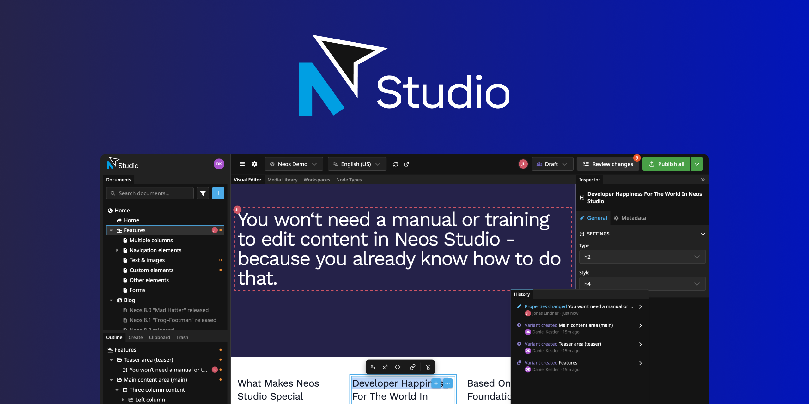

# Medienreaktor.NeosStudio

[](https://packagist.org/packages/medienreaktor/neos-studio)
[](https://www.php.net/)
[](https://github.com/medienreaktor/Medienreaktor.NeosStudio/actions/workflows/ci.yml)
[](LICENSE)



**A revolutionary, blazingly fast, collaborative (multiplayer!) editing UI for Neos 9.** Built from scratch on a clean HTTP API — fully independent of `Neos.Neos.Ui`, free to make its own architectural choices. This is what content editing in Neos can feel like: instant, fluid, together with your team, and open for extension from day one.

Neos Studio is a modern single-page application (Vite + React + TypeScript + TanStack Query + Tailwind CSS v4) that talks to Neos exclusively through [Neos.Api](https://github.com/medienreaktor/Medienreaktor.NeosApi) — the OAuth-secured HTTP API (OpenAPI-described, secured by Neos.OAuth) over the Event-Sourced Content Repository — plus the Studio API, operations it adds to Neos.Api itself. No Fusion-rendered backend modules, no shared React runtime with the classic UI — just a fast, typed, cache-smart client in front of a well-defined, documented API.

> **Why a new UI?** The classic Neos UI is a great piece of engineering that has served editors well for years — and Studio owes a lot to the ideas it pioneered. But some of its 2016-era architectural constraints are hard to move past today: the plugin API ties extensions to React 16, and the internal wire protocol was never designed as a public contract. Neos Studio starts from a different premise: an API-first backend, a lean modern frontend, and extensibility through observable registries that _are_ the public contract. It grows alongside the classic UI, adopting editing surfaces one at a time.

## Highlights

### 🤝 Collaborative editing — multiplayer for Neos

Edit **together in the same workspace, live**. Every shared workspace offers a _Collaborative_ entry in the workspace switcher: pick it, and you and your colleagues edit the same content directly — no personal-workspace detours, no publish-to-see-each-other, no conflicts to untangle afterwards.

- **See who's there**: avatar initials next to the switcher, markers on the document a colleague is on (document tree) and the element they're focusing (content outliner _and_ live preview, outlined in their color with a nametag).
- **See what they do, as it happens**: colleagues' edits stream in within ~2 seconds — or in well under a second with the realtime sidecar (below). Changed elements re-render **in place** in the preview (out-of-band rendering — your scroll position and your own inline edits survive); structural changes refresh the trees.
- **Nothing extra to install**: no WebSocket server, no Node sidecar, no message broker required. The Event-Sourced Content Repository already keeps one totally ordered change log per workspace — Studio simply tails it over plain HTTP through Neos.Api's workspace events. If it runs Neos 9, it runs multiplayer.
- **Scales up when you do**: an **optional realtime sidecar** — a small [Hocuspocus](https://github.com/ueberdosis/hocuspocus)-based WebSocket server — upgrades the transport to instant push: presence without heartbeats, a push the moment a workspace changes instead of every editor polling, sub-second latency. Studio falls back to plain polling automatically whenever the sidecar is unreachable, and back again when it returns. See [the realtime sidecar](#the-realtime-sidecar-optional).
- **Emergent, not a mode**: sessions are ordinary Neos `SHARED` workspaces (create them in the Workspaces module, manage access with the usual roles). Two people in the same workspace — that _is_ the multiplayer. Publishing the session to live works exactly like publishing any workspace.

### 🗂️ Task workflow — feature branches for content

Content work, organized like code: every task is a **feature branch**. Creating a task spins up a workspace of its own, so an editor can pick a task up, check it out, do the work and send it to review — without touching live or stepping on anyone else's changes.

- **A Kanban board, as a panel**: task branches as cards in status columns — _Open_, _In review_, _Done_ — with assignee and comment count. **Dragging a card drives the workflow**: into _In review_ submits the task, back to _Open_ reopens it.
- **Review before done**: dropping a card on _Done_ never publishes blindly — it opens the Review Changes dialog on the task's workspace, so a reviewer inspects the changes and picks what to publish. Reviewers are whoever holds the configurable reviewer role (default: `Neos.Neos:LivePublisher`).
- **Completion is event-driven**: a catch-up hook on the Content Repository's event stream watches task workspaces — once the branch is fully published, the task flips to done and everyone involved is notified, no matter which surface (or API client) triggered the publish.
- **One-click checkout** from the board, the task dialog or the workspace switcher, where task branches sit in their own group with **status-colored badges**. Creating a task — from the switcher or the board — checks it out for you immediately.
- **Comments on tasks**: every task carries its own discussion thread; submitting for review and reopening take a comment, too.
- **Notifications built in**: a bell in the top bar collects assignments, review requests, reopens, comments and completions — clicking one jumps straight to the task.
- **Ordinary Neos underneath**: task branches are plain `SHARED` workspaces plus task metadata, with access through standard workspace roles — the creator and reviewers manage, the assignee collaborates, and uninvolved editors never see task branches at all. Publishing, syncing and conflict resolution work like on any workspace.

### 🔎 Side-by-side review — the pull request, for pages

Reviewing a workspace should not mean reading property values. **Compare changes** opens a full-screen view of one changed page in two rendered versions: live on the left, the reviewed workspace on the right.

- **The change is marked in the page itself**, in the Studio's change colors — edited elements outlined blue on both sides, an added one green on the right, a removed one red on the left, each with a badge naming what happened.
- **Both sides scroll to the same content**, not to the same pixel: the frames report where their content elements sit, and the shell pairs them by node aggregate id into a map between the two scroll positions — so an addition halfway down never drifts the two versions apart.
- **Step through the changes**: next/previous jumps both frames to the element under review and highlights it, starting on the first change when the page opens.
- **Decide right there**: publish or discard the page on screen, page by page, with the same conflict resolution the review dialog uses.
- **Every change reads out, marked or not**: a rendered page can only show what it renders. An alt text, a link target, an SEO title, a page setting — all of them go live with the rest and none of them are visible in a picture of the page. The detail panel below the frames lists the before/after values of the change under review, and changes with nothing to point at stay in the walkthrough, labelled as invisible instead of dropped.
- **Read-only by construction**: the frames render the ordinary edit-mode markup but carry a compare script instead of the editing guest — there is no inline editor to open, and no click that could reach one.

Sites can widen what gets marked. Neos' editing markup only annotates the properties it renders as inline-editable text, so anything a site renders into something else — an image, a background, an aria-label — has nothing to attach a mark to. Naming the properties on the element solves it:

```html

```

Purely additive: without it the change simply reads out in the detail panel instead of being marked on the page.

### 🔐 Access roles — restrict who reaches what

Dynamic, editable **access roles**: name a set of restrictions and assign editors to it, in the UI, without touching `Policy.yaml` or deploying anything. What the classic distributions solved with Sandstorm.NeosAcl, rebuilt for Neos 9 — where the node-level privilege targets that approach relied on no longer exist.

- **Four axes, one role**: which **sites**, which branches of the **document tree**, which **dimensions**, which **workspaces** (live included — "may edit the draft but not publish to live" is one unticked box) — plus the coarse capabilities (edit, create, delete, move) a role may exercise inside them.
- **Pick branches from the tree**: the Documents tab browses the real document tree; select a page, then allow or deny it, with or without its sub-pages. Allow rules turn the tree into a whitelist, deny rules cut single pages back out — the rule nearest a page wins, so "the whole section except this one page" is two clicks.
- **Permissive by default, at every turn**: a fresh role restricts nothing, an empty list means "all", and a user with **no role assigned is unrestricted** — installing this changes nothing until an administrator hands a role out. Administrators are exempt by design, so a role can never lock the last admin out.
- **Additive, but never a mash-up**: assign someone two roles and they may do what either allows — evaluated _per role_, so one role must cover the whole operation. "May edit the draft" plus "may read live" never combines into writing on live. Never the intersection, never a surprise.
- **Doomed gestures never start**: every surface asks _before_ offering. A page outside the roles renders as a plain read-only preview with the inspector disarmed (and a notice naming who can widen the role); a withheld capability greys out exactly its actions — context menus, drag & drop, the creation palette and the New-page button, action by action; a dimension value the roles block shows a lock and a tooltip instead of posing as a configuration gap. And if a role change mid-session drops the workspace someone is standing in, a blocking dialog moves them to a permitted one instead of letting the saves fail one by one.
- **Enforced, not just drawn**: the roles narrow the Studio's UI _and_ the Content Repository itself — an `AuthProviderInterface` implementation wraps Neos' own and refuses writes outside a user's roles, so a restriction holds against a hand-crafted API request too. Creating a workspace is the one write asked exactly as Neos asks it — may the base workspace be read — because the command cannot tell the personal workspace Neos sets up on a user's first login from a new shared one. Node listings and document search are filtered **server-side** as well, so a hidden page never leaks through a search hit — while unrestricted accounts (which is nearly everyone) skip the filter entirely and pay nothing. It only ever _narrows_ Neos' decision, and fails open on its own errors: a bug here degrades to "no extra restrictions", never to a locked-out editorial team.
- **The tree shows the role, not the site**: only the granted branches and the path down to them appear. The ancestors on that path render dimmed with a lock badge — signposts, not workspaces — and everything else is gone from the tree entirely. The path is resolved server-side per request, so moving a page never strands the branch below it.

### ⚡ Blazingly fast, everywhere

- **Instant loads** — a static Vite-built SPA served at `/neos/studio`, with TanStack Query caching and background revalidation. Navigating between documents doesn't reload the world; it reuses what's already in the cache.
- **Silent auth** — Studio provisions its own first-party OAuth client (authorization code + PKCE) on first load. Logged-in backend users get a token silently: no consent screen, no setup, and automatic client-side token refresh.
- **Lazy everything** — document tree and content outliner load on demand, honoring the Neos `loadingDepth` settings, with node type icons, visibility states and pending-change markers.

### 🧩 Dockable panel system

The entire workspace is built from **panels**: document tree, content outliner, inspector, media browser, node creation, clipboard, preview — every surface is a panel that can be docked, resized and toggled. Panels live in a `PanelRegistry`, which means third-party packages register their own panels into the same layout system the built-in ones use. Your panel is a first-class citizen, not an iframe in a corner.

### ✍️ Lightweight inline Rich Text Editing

Inline editing runs on **TipTap 3** — a lean, headless, ProseMirror-based editor instead of a monolithic CKEditor build. The RTE lives _inside the preview iframe_ with a floating toolbar, driven by a guest-side formatting registry, so what you edit is exactly what renders. The same normalized formatting engine powers the inspector's rich-text editor, and the shared Link Editor (with a pluggable tab registry) handles links in both the RTE and the inspector's link fields.

### 🖱️ Context menus and drag & drop

- **Context menus** on every node — in the document tree, the content outliner and the media browser — with copy, cut, paste, delete, hide and more.
- **Drag & drop node moves** in the trees, constraint-aware.
- **Drag-to-create**: pick a node type from the creation panel and drop it straight into the live preview, or use the insert dialog (before / inside / after, filtered by node type constraints).
- A **node clipboard** that survives navigation, with its own panel and document/content separation.

### 🔍 A complete, extensible inspector

Full parity with the classic inspector — and then some:

- **Editors**: text, textarea, rich text, select box (with data source support), references, asset / assets, image, link, date & time, range slider, boolean, code, node type, URI path segment … all registered through an editor registry, all replaceable.
- **Views**: NodeInfo, Column, Table and TimeSeries views plus data-source-driven widgets — through a views registry.
- **Validators**: the `Neos.Neos/Validation` built-ins with live inline errors, tab badges and save-blocking — through a validators registry.
- **ClientEval** support (`ClientEval:` expressions for hidden state and editor options), transient values, and **dimension shine-through indicators** with one-click "create variant" — in the inspector _and_ directly in the preview.
- **Property help** (`ui.help.message` and `ui.help.thumbnail`) — a popover beside the property label, just like the classic UI.

### 🌐 Full editing environment

- **Live preview** with an inline-editing guest bridge — edit content directly in the rendered page.
- **Media module**: full asset management plus picker mode for asset editors.
- **Workspaces, sites and dimensions**: switchers for all three, pending-change tracking, publish and discard.
- **Trash panel**: deleting a node is a soft removal, so every deleted page waits in the trash until the deletion is published — with who deleted it and when, and one click to restore it (deleted parent pages come back with it).
- **User & profile management**: administer users, and every editor gets self-service profile settings (name, email, password, interface language).
- **Localized UI** in English and German via Neos' own XLIFF infrastructure (450+ keys) — translated the Neos way, extendable the Neos way.
- **Consistent design system**: shadcn-style components on [Base UI](https://base-ui.com) primitives, on semantic design tokens from Figma, with light and dark themes. Focused, familiar.

### 🔌 Extensible by design — registries all the way down

Extensibility isn't bolted on; it's the architecture. Studio's building blocks are **observable registries**:

| Registry             | What you can add                                                                                                                                                                        |
| -------------------- | --------------------------------------------------------------------------------------------------------------------------------------------------------------------------------------- |
| Panels               | Whole new workspace surfaces, docked anywhere                                                                                                                                           |
| Inspector editors    | Custom property editors for any node type property                                                                                                                                      |
| Inspector views      | Custom read-only views and widgets                                                                                                                                                      |
| Validators           | Custom client-side validation                                                                                                                                                           |
| Link editor tabs     | New link source types in the shared link modal                                                                                                                                          |
| Modals               | App-level dialogs                                                                                                                                                                       |
| Workspace decorators | Badges and grouping for workspaces in the switcher and administration (this is how task branches get their status colors)                                                               |
| Node decorators      | Per-node visuals on every tree row: replace the type icon, layer badge overlays onto it, tint or dim the whole row (this is how hidden nodes dim and deleted nodes get their red badge) |
| Keyboard shortcuts   | App-wide shortcuts alongside the built-in ones                                                                                                                                          |

Third-party packages ship a small IIFE bundle that binds to the shell's public plugin API (`window.NeosStudio` — React instance, `useStudio()` app state and actions (`useStudioActions()` for just the stable actions), and all registries) with full TypeScript types generated from the shell's own source. The shell injects your bundle via a single `Settings.yaml` entry — no build-system fusion, no webpack surgery, no version lock-in dance. Registration is late-bindable and observable: register, and the UI re-renders.

The types ship with the package as one bundled declaration file, `Resources/Public/Studio/types/index.d.ts` (built by `npm run build:plugin-types`, which runs at the end of `npm run build`). Map the import to it in your plugin's `tsconfig.json` and keep it external in your bundler (resolved to `window.NeosStudio` at runtime); `react` stays external too, so install `@types/react` and map `react` to it too (the declaration file lies outside your package, so TypeScript would look for `react` next to it):

```jsonc
"paths": {
  "@medienreaktor/neos-studio": ["../../Packages/Plugins/Medienreaktor.NeosStudio/Resources/Public/Studio/types/index.d.ts"],
  "react": ["./node_modules/@types/react"],
  "react/*": ["./node_modules/@types/react/*"],
  "react-dom": ["./node_modules/@types/react-dom"]
}
```

### Plugin API version 2

`NeosStudio.version` is `2` since the Studio runs on Neos.Api instead of Medienreaktor.NeosApi. What a version 1 plugin has to change:

- **Nodes** are Neos.Api's `Node` (`useStudio().selectedDocument`, `inspectedNode`, inspector views, node decorators): `nodeAggregateId` instead of `address`/`aggregateId`, `workspaceName` instead of `workspace`, the dimension space point is a JSON string, `properties[name]` is the plain value instead of `{value, type}`, and `tags` are the node's own tags, its inherited ones are `inheritedTags`.
- **Node addresses** are `NodeAddress` objects (`contentRepositoryId`, `workspaceName`, `dimensionSpacePoint`, `nodeAggregateId`) instead of strings - in the Studio actions (`inspectAddress`, `navigateToNode…`, `nodeEdited`, `nodesEdited`, `reportInlineEdit`) and `PropertyEditorProps.nodeAddress`. A `Node` is one.
- **Asset values** of asset/image properties are written as `{id}` (read as `{id, url}`) instead of `{__flow_object_type, __identifier}`.
- **Workspaces** are Neos.Api's `Workspace`: `baseWorkspaceName` and `ownerId` instead of `baseWorkspace` and `owner`, and there is no `extensions` bag - a workspace decorator keeps its own data (see `features/tasks/decorationData.ts`).
- **Node types** are Neos.Api's `NodeType` (`isAbstract` instead of `abstract`), sites its `Site`.
- **`apiFetch`** talks to Neos.Api (`/api`, see `/api/docs`); the old Medienreaktor.NeosApi routes are gone, the Studio's own operations are content repository scoped (e.g. `/api/cr/{contentRepositoryId}/tasks`).
- **Custom preview guest scripts**: the `…ContextPath` fields of the guest protocol are `…NodeAddress` fields holding the NodeAddress JSON, `guest-ready` carries the guest's `labels` (the host answers with `init`), and the guest answers `flush` with `flushed`.
- `modals` is deprecated in favour of `settingsSections` (still an alias).

**Start here:** [Medienreaktor.NeosStudio.ExamplePlugins](https://github.com/medienreaktor/Medienreaktor.NeosStudio.ExamplePlugins) — a copy-me boilerplate that registers an example panel, a custom inspector editor (a color picker) and a node decorator from a completely separate package.

## The package family

| Package                                                                                                             | What it is                                                                                                                                                                                                                                             |
| ------------------------------------------------------------------------------------------------------------------- | ------------------------------------------------------------------------------------------------------------------------------------------------------------------------------------------------------------------------------------------------------ |
| [Neos.Api](https://github.com/medienreaktor/Medienreaktor.NeosApi) + [Neos.OAuth](https://github.com/medienreaktor/Neos.OAuth)   | The foundation: the HTTP API for Neos 9 (nodes, workspaces, media, users, sites, views, data sources), described with OpenAPI and secured with OAuth 2 (authorization code + PKCE, refresh token rotation, scopes narrowing the account's privileges). |
| **Medienreaktor.NeosStudio** (this package)                                                                         | The editing UI built on that API, plus the Studio's operations of the Neos API (tasks, notifications, access roles, preview links, the creation dialog) and the realtime sidecar's change signal.                                                                                       |
| [Medienreaktor.NeosStudio.ExamplePlugins](https://github.com/medienreaktor/Medienreaktor.NeosStudio.ExamplePlugins) | Plugin boilerplate: example panel + example inspector editor, with the full build setup for extending Studio from your own package.                                                                                                                    |

## Getting started

Requires Neos `^9.2`, PHP `^8.4` and Node 22 (pinned via `.nvmrc`) for building the frontend.

```sh
composer require medienreaktor/neos-studio

# create the Neos.OAuth tables
./flow doctrine:migrate

# build the SPA
cd DistributionPackages/Medienreaktor.NeosStudio/Resources/Private/Studio
nvm use
npm install
npm run build      # outputs to Resources/Public/Studio/ (committed to the repo), plugin types to its types/

# publish and flush on the Neos side
./flow resource:publish
./flow flow:cache:flush
```

Open `/neos/studio` and log in with your Neos backend account. That's it — Studio lazily provisions its own OAuth client on first load; there is nothing to configure.

## The realtime sidecar (optional)

Multiplayer needs no extra infrastructure — but it can use some. `Resources/Private/Realtime/` ships a small [Hocuspocus](https://github.com/ueberdosis/hocuspocus) WebSocket server that upgrades Studio's collaboration transport from HTTP polling to push. Without it, everything keeps working: collaboration falls back to plain HTTP polling of the workspace's events in Neos.Api (2s change feed; presence - who else is in the workspace - is only available through the sidecar). The fallback is also automatic at runtime — while the sidecar is unreachable, connected Studios poll; when it comes back, they stop.

One WebSocket per editing session (document name `workspace:<contentRepositoryId>:<workspaceName>`):

- **Presence** — clients announce their position as stateless messages; the sidecar keeps a server-authoritative roster per workspace (identity comes from the validated token, never from the client) and broadcasts changes instantly. No heartbeats, no TTL ghosts: a closed tab leaves with its connection.
- **Change signal** — the sidecar watches the head of each active workspace's content stream once per `FEED_INTERVAL_MS` through a shared-secret server-to-server endpoint (`/neos/studio/realtime/cr/{contentRepositoryId}/workspaces/{workspaceName}/head`) and tells every editor in the workspace when it moved (`{type: 'changed', contentStreamId, sequenceNumber}`). No event contents pass through the sidecar: each Studio then reads the new events from Neos.Api's workspace events with its own token, so the API's per-node read permissions apply. Remote edits reach colleagues in well under a second, without every editor polling every 2s.
- **Yjs seam** — the (currently unused) Yjs document behind each connection is where collaborative text editing attaches later, without a new connection concept.

### Authentication

Two credentials, deliberately separate:

- Every **client connection** authenticates with the editor's own OAuth bearer token. The sidecar validates it against Neos.Api (a read of `/api/cr/{contentRepository}/workspaces/{name}` proves the token is alive AND the user may read that workspace - an unreadable one is a 404) and resolves identity via `/api/me`.
- The sidecar's own **head reads** authenticate with a shared secret (`X-Realtime-Secret`), configured on both sides: `Medienreaktor.NeosStudio.realtime.sharedSecret` (Neos) and `REALTIME_SHARED_SECRET` (sidecar). While the Neos-side secret is empty, the server-to-server endpoint answers 404 — an unconfigured installation exposes nothing.

### Running

```bash
cd DistributionPackages/Medienreaktor.NeosStudio/Resources/Private/Realtime
npm install
REALTIME_SHARED_SECRET=... NEOS_BASE_URL=https://your-site npm start
```

| Variable                  | Default                 | Purpose                                                     |
| ------------------------- | ----------------------- | ----------------------------------------------------------- |
| `PORT`                    | `1234`                  | Listen port                                                 |
| `NEOS_BASE_URL`           | `http://127.0.0.1:8080` | Base URL of the Neos installation                           |
| `NEOS_HOST_HEADER`        | _(none)_                | Host header override for internal hostnames                 |
| `REALTIME_SHARED_SECRET`  | _(required)_            | Must equal `Medienreaktor.NeosStudio.realtime.sharedSecret` |
| `FEED_INTERVAL_MS`        | `1000`                  | Feed tail cadence per active workspace                      |

Then point the Studio at it:

```yaml
Medienreaktor:
  NeosStudio:
    realtime:
      websocketUrl: "wss://realtime.your-site.example"
      sharedSecret: "..." # openssl rand -hex 32
```

TLS termination is expected to happen in front (reverse proxy); the sidecar itself speaks plain WS/HTTP.

## Development

The SPA sources live in `Resources/Private/Studio/` (Vite, `src/`, `index.html`); the build output goes to `Resources/Public/Studio/`. The realtime sidecar lives next to it in `Resources/Private/Realtime/` (plain Node, no build step).

```
src/
  main.tsx              entry: installs plugin-API globals, mounts the app
  app/                  application shell, providers, shared QueryClient
  auth/                 authorization-code + PKCE flow, token refresh
  api/                  data layer: typed apiFetch(), query-key factory, one hook file per resource
  components/ui/        shadcn-style components on Base UI primitives (owned code)
  features/             one folder per feature: tree, inspector, preview, media,
                        panels, creation, clipboard, editing, links, dimensions,
                        workspaces, tasks, notifications, collaboration, sites,
                        users, profile, modals, shortcuts
  guest/                the script injected into the preview iframe:
                        inline editing, TipTap RTE, toolbar, link editing
  plugin-api/           the public plugin API surface (window.NeosStudio)
  lib/, hooks/          shared utilities
```

Conventions: every query key comes from `api/keys.ts` (never inline literals); one hook file per API resource; feature folders own their UI and hooks; `@/` aliases `src/`. Styling is Tailwind v4 (CSS-first config) on semantic tokens; primitives are Base UI (`@base-ui/react`), not Radix.

### Design tokens

Colours, radii and text styles come from the [Neos Studio Figma file](https://www.figma.com/design/ks1Uf9OdtvGCA9zjDsSYCu/) through `medienreaktor/figma-tools`, configured by `figma-tools.json`. The Figma dumps (`figma-variables.json`, `figma-text-styles.json`) are checked in, so the export is reproducible without Figma access. From a project that installs figma-tools:

```bash
composer exec -- figma-download --base-path <path to this package>   # refresh the dumps; needs FIGMA_MCP_TOKEN
composer exec -- figma-import --base-path <path to this package>     # regenerate src/styles/*.css
```

`src/styles/{primitives,semantics,sizes,texts}.css` are generated: never hand-edit them, change Figma and re-export. Components use semantic utilities only (`bg-card`, `text-muted-foreground`, `border-divider`, `type-body`, `type-icon-s`), never palette shades or `dark:` variants; Tailwind's own font-size scale is switched off (`src/text-scale.css`). The theme axis is `data-theme="light|dark"` on `<html>`, and any subtree can set its own `data-theme` to render in the other mode. The root font size is left at the browser default, and every length, text sizes included, is in rem, so Studio follows the reader's default font size - also when it changes while Studio is open. That includes lengths JavaScript computes with: graph geometry and panel rects are plain numbers meaning rem, rendered as `${value}rem`. Pixels only exist where code reads the screen - pointer positions, scroll offsets, element and window sizes - and `lib/rem.ts` converts them there, reading the root font size fresh each time.

Sizes are designed for a 16px root on Tailwind's spacing scale, where one step is 4px: `h-8.5` is 34px, `p-3.5` is 14px. Pick the step for the pixel size the design asks for, in half steps at most. Up to 1.18 Studio was laid out at a 15px root; its sizes were carried over by mapping every step to the half step nearest its old pixel size, which is why many of them are half steps (`h-8.5` where the 15px layout had `h-9`). The text styles bring their own line heights from Figma (`type-body` is 18.75px), so a component sets `leading-*` only where it deliberately departs from its style.

### Styling plugins

A plugin's markup is not part of Studio's Tailwind build, so it ships its own CSS. To look like Studio it needs no build of its own and no figma-tools: the shell declares its design tokens as CSS custom properties at runtime, switched with the theme, and plain CSS reads them.

```css
.my-plugin-field {
  padding: calc(var(--spacing) * 2) calc(var(--spacing) * 3);
  border: 1px solid var(--color-border);
  border-radius: var(--radius-md);
  background: color-mix(in srgb, var(--color-input) 30%, transparent);
  color: var(--color-foreground);
  font-size: var(--text-body);
  line-height: var(--text-body--line-height);
}
```

The variables a plugin may rely on are listed in [`src/plugin-api/css-variables.json`](Resources/Private/Studio/src/plugin-api/css-variables.json):

- **Colours:** the UI set, `--color-background`, `-foreground`, `-card`, `-popover`, `-muted`, `-accent`, `-border`, `-divider`, `-input`, `-ring`, `-placeholder`, `-link`, `-scrim`, and the roles `primary`, `secondary`, `destructive`, `warning`, `success`, `variant`. A role is its fill (`--color-primary`), the text on that fill (`-foreground`), the role as a text colour on a surface (`-text`), and a translucent background (`-tint`).
- **Radii:** `--radius-sm`, `-md`, `-lg`, `-xl`.
- **Text:** one `--text-{style}` per Studio text style with its `--text-{style}--line-height`: `default`, `body`, `body-strong`, `small`, `small-strong`, `caption`, `count`, `count-small`, `overline`, `heading-s`/`-m`/`-l`, `code`, `code-small`, and the icon sizes `icon-xs` to `icon-3xl`. Weights are not variables: the `-strong` styles are 500, `count`, `count-small`, `overline` and the headings 600, the rest 400; `overline` is also upper case with `letter-spacing: 0.025em`.
- **Fonts and spacing:** `--font-sans`, `--font-mono`, `--font-icon`, and Tailwind's spacing unit `--spacing` (4px at the default root).

Sizes in a plugin follow the same rule as Studio's own: lengths in rem, also where JavaScript computes them, and pixels only where the plugin reads the screen, converted with the root font size read at that moment (`parseFloat(getComputedStyle(document.documentElement).fontSize)`). Then a reader's larger default font size scales the plugin with the shell, even while Studio is open.

Everything else in the build is internal. The build fails when a listed variable goes missing, so a rename in Figma is caught in Studio rather than in a plugin; an intended rename keeps the old name alive through `extraNames` in `figma-tools.json` until the known plugins have moved. Larger plugin UIs should use Studio's components rather than restyle them; exposing those through the plugin API is planned.

### The Studio API

What the Studio adds to Neos (tasks, notifications, preview links, access roles, the review, history and trash of a workspace) are operations of Neos.Api's API itself: [neos/openapi](https://github.com/neos/openapi) Api Classes in `Classes/Endpoint/<Tag>/<Tag>.php` with schematic/jsonschema types (`Schema/`, `RequestBody/`, `Response/`), added to `Neos.OpenApi.FlowAdapter.apis.neos.classes`. So they share everything with Neos.Api's own operations:

- the paths below `/api`, content-repository ones below `/api/cr/{contentRepositoryId}` like Neos.Api's - the shell uses the content repository of the selected site;
- the OpenAPI document (`/api/openapi.json`) and its docs (`/api/docs`); the SPA's types are generated from it (`npm run api:schema` → `src/api/neos/schema/openapi.ts`, never edited by hand), `src/api/studio/schema` names the Studio's models;
- OAuth scopes that are Neos privileges: each capability is a `Neos\Api\Security\ApiPrivilege` target in `Policy.yaml` whose matcher is the scope (`studio.tasks.read`, … in `Security\StudioScopes`). The account's roles decide what is possible, the token's scopes only narrow it down; both are checked before an operation runs, rules depending on a workspace by the operation (`Security\StudioCallers`);
- problem documents, the cache headers, and the tools of Neos.Mcp's MCP server.

Follow Neos.Api's conventions (its `CLAUDE.md`) for new operations. The realtime sidecar's head endpoint is no operation: it authenticates with a shared secret, not a token (`RealtimeController`).

`npm run dev` starts the Vite dev server for fast iteration; end-to-end auth is tested against the built-and-served shell at `/neos/studio` (the OAuth redirect URIs are bound to that origin).

## License

Neos Studio is free software, released under the [GNU General Public License, version 3 or later](LICENSE).

Copyright (C) 2026 medienreaktor GmbH

---

Built by [medienreaktor](https://www.medienreaktor.de) with ❤️ for the Neos community. Feedback, issues and plugin experiments very welcome — this is where the Neos editing experience is headed. Come shape it.
